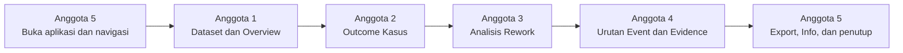
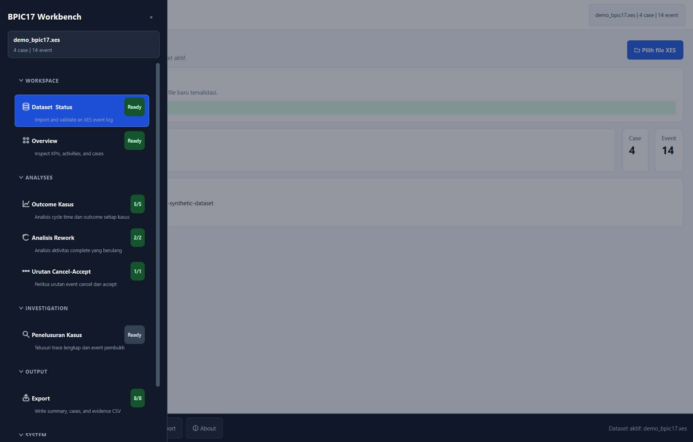
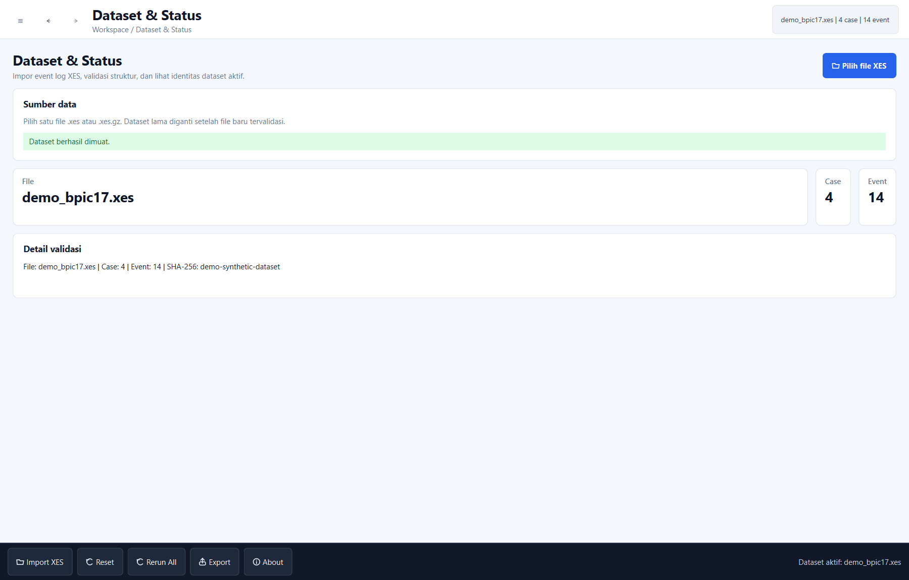
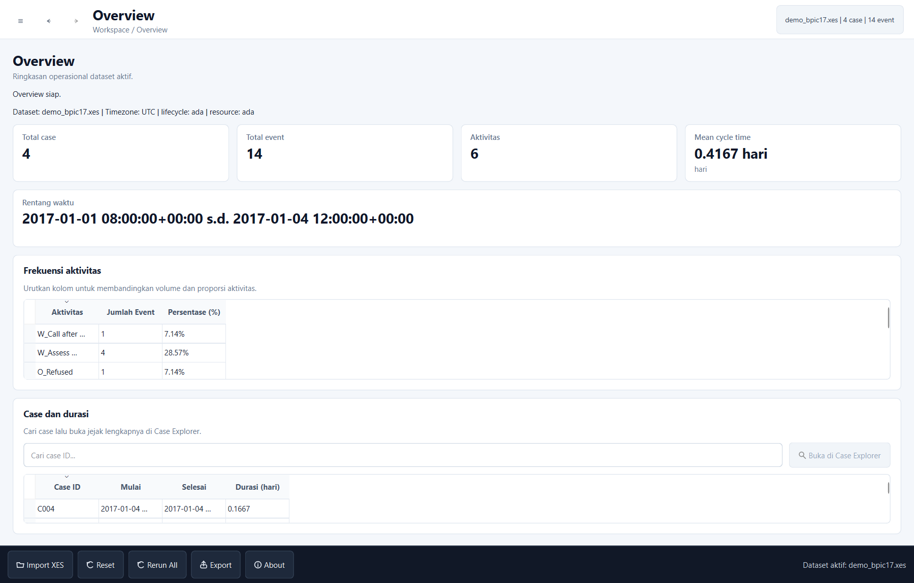
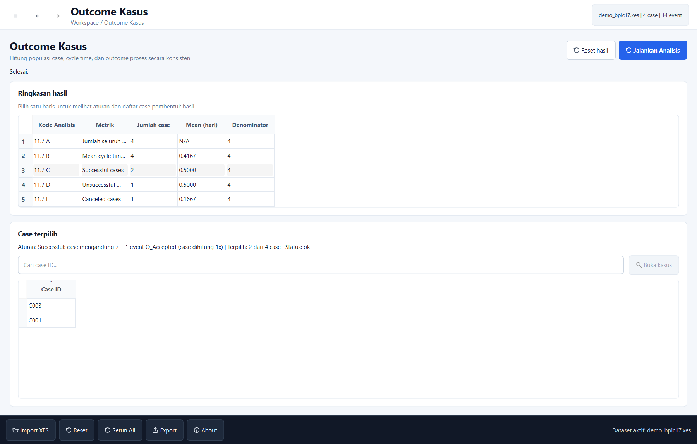
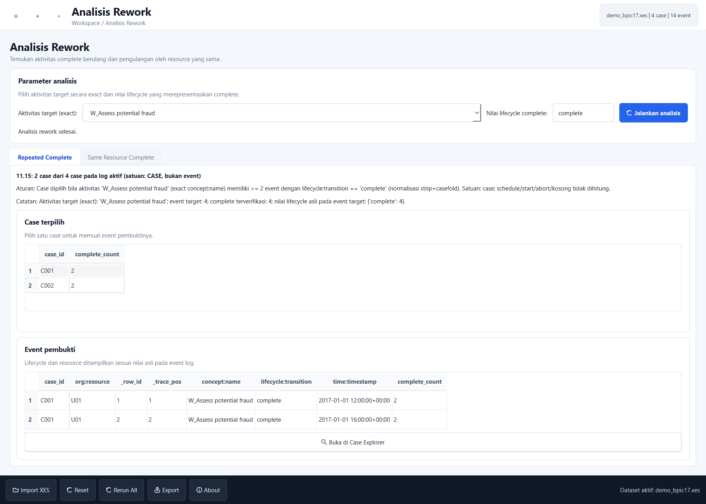
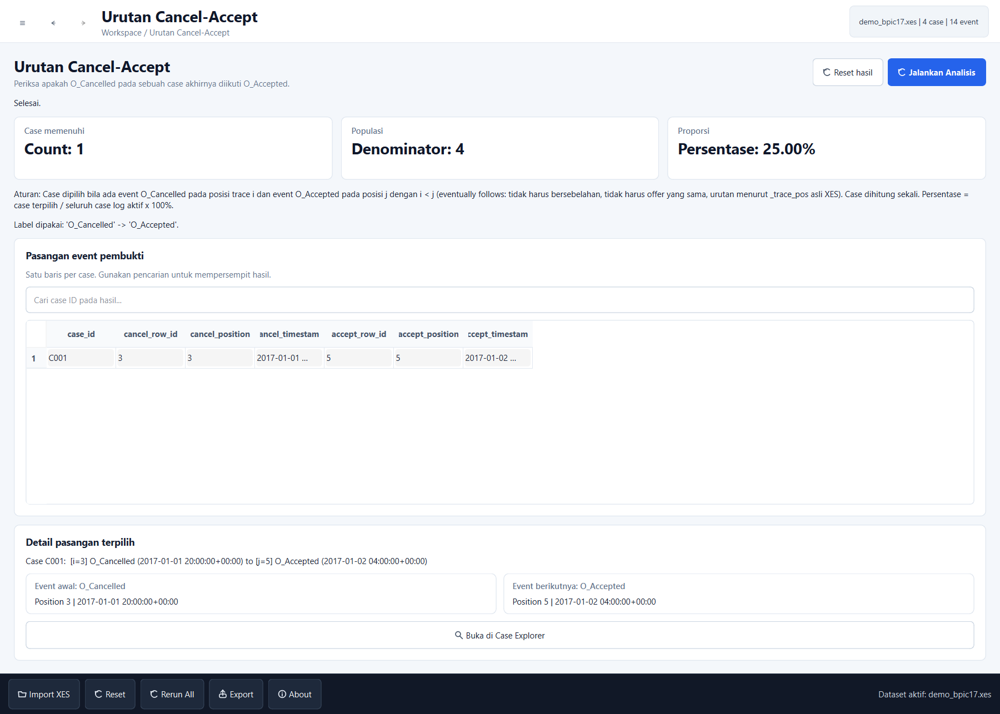
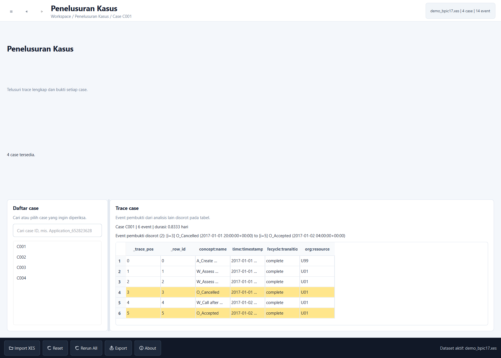
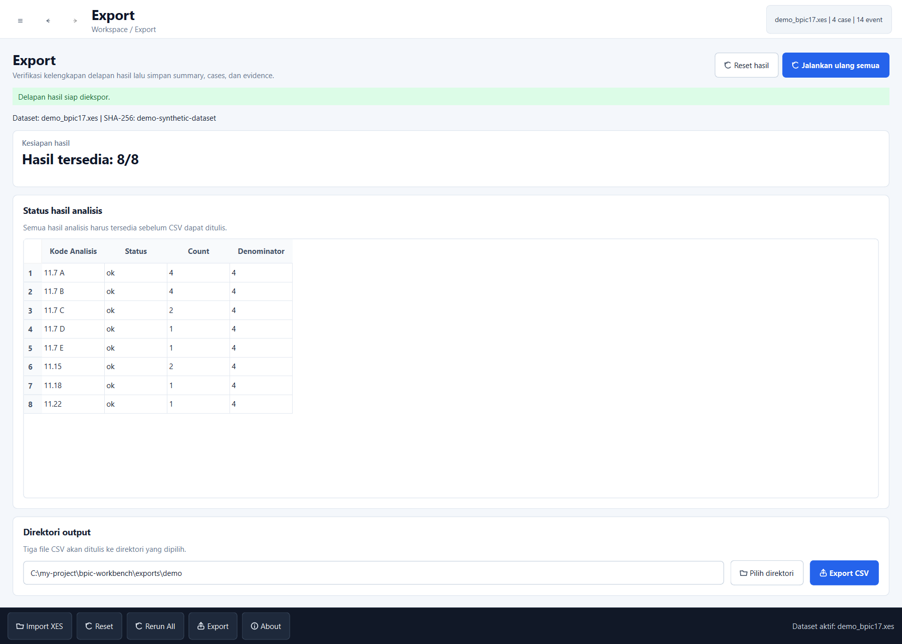
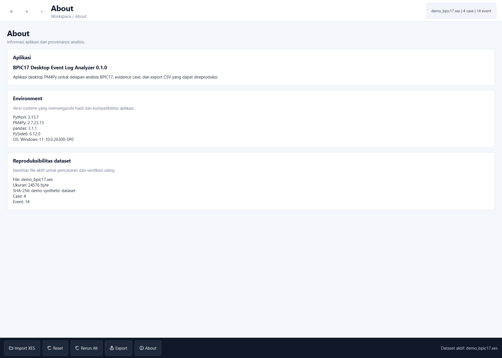

# Tugas dan Naskah Demo BPIC Workbench

## 1. Tujuan demo

Demo memperlihatkan alur lengkap aplikasi mulai dari membuka event log XES, memeriksa kualitas dataset, menjalankan seluruh analisis, menelusuri event pembukti, sampai mengekspor hasil yang dapat diaudit.

Screenshot dalam dokumen ini menggunakan `demo_bpic17.xes`, yaitu dataset sintetis berisi 4 case dan 14 event. Dataset tersebut dibuat khusus untuk dokumentasi dan tidak menggantikan dataset BPIC17 yang disepakati untuk presentasi akhir.

## 2. Persiapan sebelum demo

Jalankan dari root repository menggunakan Python 3.13:

```powershell
.\.venv\Scripts\Activate.ps1
python manage.py run
```

Pastikan hal berikut sudah siap:

- file XES yang akan digunakan dapat dibaca;
- direktori output export dapat ditulis;
- resolusi layar cukup untuk menampilkan tabel;
- seluruh anggota mengetahui bagian dan urutan demonstrasinya;
- bila memakai dataset final, nama file dan SHA-256 sudah dicatat.

Screenshot dokumentasi dapat dibuat ulang dengan:

```powershell
python scripts\capture_demo_screenshots.py
```

## 3. Pembagian anggota

| Anggota | Bagian utama | Halaman | Estimasi |
|---|---|---|---:|
| Anggota 1 | Import, validasi, dan ringkasan dataset | Dataset & Status, Overview | 2 menit 30 detik |
| Anggota 2 | Cycle time dan outcome case | Outcome Kasus | 1 menit 30 detik |
| Anggota 3 | Analisis aktivitas complete berulang | Analisis Rework | 2 menit |
| Anggota 4 | Urutan event dan penelusuran evidence | Urutan Cancel-Accept, Penelusuran Kasus | 2 menit 30 detik |
| Anggota 5 | Pembukaan, integrasi, export, dan penutup | Navigation Drawer, Export, About | 2 menit 45 detik |

Estimasi total demo: 11 menit 15 detik.



## 4. Pembukaan dan navigasi

### Anggota 5 — Navigation Drawer

Lokasi halaman/komponen:

- tekan tombol menu pada kiri atas;
- shortcut alternatif: `Ctrl+B`;
- drawer dapat ditutup melalui tombol close, backdrop, `Escape`, atau memilih halaman.



Keterangan screenshot: navigation drawer sedang terbuka di atas halaman `Dataset & Status`. Drawer menampilkan kelompok `WORKSPACE`, `ANALYSES`, `INVESTIGATION`, `OUTPUT`, dan `SYSTEM`, beserta status kesiapan setiap halaman.

Teks demo:

> Aplikasi ini adalah BPIC Workbench, sebuah aplikasi desktop untuk memproses event log XES. Seluruh fitur diakses melalui navigation drawer. Badge pada setiap menu menunjukkan kesiapan dataset dan hasil analisis. Tombol aksi global di bagian bawah dapat digunakan untuk import, reset, menjalankan ulang analisis, export, dan membuka informasi aplikasi.

Aksi yang dilakukan:

1. Buka navigation drawer.
2. Tunjukkan pengelompokan menu.
3. Jelaskan badge `Ready`, `5/5`, `2/2`, `1/1`, dan `8/8`.
4. Pilih `Dataset & Status`.
5. Serahkan demo kepada Anggota 1.

## 5. Import dan ringkasan dataset

### Anggota 1 — Halaman Dataset & Status

Lokasi halaman:

`Tombol menu > WORKSPACE > Dataset & Status`

Shortcut: `Ctrl+1`.



Keterangan screenshot: halaman `Dataset & Status` setelah dataset berhasil dimuat. Halaman menampilkan nama file, jumlah case, jumlah event, status validasi, dan SHA-256.

Teks demo:

> Pada halaman Dataset dan Status, pengguna memilih file `.xes` atau `.xes.gz`. File diproses di worker thread agar antarmuka tetap responsif. Setelah validasi selesai, aplikasi membuat satu EventStore yang digunakan bersama oleh seluruh halaman. Identitas file, jumlah case, jumlah event, dan SHA-256 ditampilkan untuk kebutuhan reproduksibilitas.

Aksi yang dilakukan:

1. Tekan `Pilih file XES` atau gunakan `Ctrl+O`.
2. Pilih file demo/final.
3. Tunggu pesan `Dataset berhasil dimuat`.
4. Tunjukkan:
   - nama file;
   - jumlah case;
   - jumlah event;
   - SHA-256;
   - warning, bila tersedia.

Hal yang dijelaskan:

- dataset lama dibersihkan sebelum dataset baru diaktifkan;
- atribut wajib divalidasi;
- hasil dataset lama tidak boleh tercampur dengan dataset baru;
- setiap panel memakai objek `EventStore` yang sama.

### Anggota 1 — Halaman Overview

Lokasi halaman:

`Tombol menu > WORKSPACE > Overview`

Shortcut: `Ctrl+2`.



Keterangan screenshot: halaman `Overview` menampilkan KPI dataset, rentang waktu, frekuensi aktivitas, serta daftar case dan durasinya.

Teks demo:

> Overview dihitung otomatis setelah dataset aktif. Bagian atas menampilkan total case, event, aktivitas, mean cycle time, dan rentang timestamp. Tabel pertama memperlihatkan frekuensi aktivitas, sedangkan tabel kedua dapat digunakan untuk mencari case dan membuka trace lengkapnya.

Aksi yang dilakukan:

1. Tunjukkan kartu KPI.
2. Jelaskan rentang timestamp dan timezone.
3. Tunjukkan frekuensi aktivitas.
4. Cari salah satu case pada kolom pencarian.
5. Jelaskan bahwa tombol `Buka di Case Explorer` menghubungkan Overview dengan Penelusuran Kasus.

Transisi ke Anggota 2:

> Dataset sudah tervalidasi dan ringkasan dasarnya sudah terlihat. Berikutnya, Anggota 2 akan menjelaskan cycle time dan outcome setiap case.

## 6. Cycle time dan outcome kasus

### Anggota 2 — Halaman Outcome Kasus

Lokasi halaman:

`Tombol menu > ANALYSES > Outcome Kasus`

Shortcut: `Ctrl+3`.



Keterangan screenshot: halaman `Outcome Kasus` setelah analisis selesai. Tabel ringkasan menampilkan lima kode analisis, jumlah case, mean hari, denominator, dan daftar case pembentuk hasil terpilih.

Teks demo:

> Halaman Outcome Kasus menghitung lima metrik. Pertama adalah jumlah seluruh case. Kedua adalah mean cycle time. Tiga metrik berikutnya mengelompokkan case yang accepted, refused, atau berakhir cancelled. Semua hasil dihitung dari dataset aktif dan bukan angka yang di-hard-code.

Aksi yang dilakukan:

1. Tekan `Jalankan Analisis`.
2. Jelaskan setiap baris:
   - `11.7 A`: jumlah seluruh case;
   - `11.7 B`: mean cycle time;
   - `11.7 C`: case yang mengandung `O_Accepted`;
   - `11.7 D`: case yang mengandung `O_Refused`;
   - `11.7 E`: case yang berakhir dengan `O_Cancelled`.
3. Pilih satu baris hasil.
4. Tunjukkan aturan, denominator, status, dan daftar case.
5. Pilih case dan jelaskan tombol `Buka kasus`.

Hasil pada dataset screenshot:

| Metrik | Hasil |
|---|---:|
| Seluruh case | 4 |
| Mean cycle time | 0,4167 hari |
| Accepted | 2 |
| Refused | 1 |
| Berakhir cancelled | 1 |

Transisi ke Anggota 3:

> Setelah outcome case diketahui, Anggota 3 akan menunjukkan bagaimana aplikasi mendeteksi aktivitas complete yang dikerjakan berulang.

## 7. Analisis rework

### Anggota 3 — Halaman Analisis Rework

Lokasi halaman:

`Tombol menu > ANALYSES > Analisis Rework`

Shortcut: `Ctrl+4`.



Keterangan screenshot: halaman `Analisis Rework` dengan tab `Repeated Complete` aktif. Bagian parameter menampilkan aktivitas target dan nilai lifecycle. Bagian bawah menampilkan case serta event pembukti.

Teks demo:

> Analisis Rework menggunakan aktivitas target secara exact dan hanya menghitung event dengan lifecycle complete. Tab Repeated Complete mencari case dengan sedikitnya dua event complete untuk aktivitas target. Tab Same Resource Complete menerapkan syarat tambahan bahwa pengulangan dilakukan resource valid yang sama.

Aksi yang dilakukan:

1. Tunjukkan aktivitas target `W_Assess potential fraud`.
2. Tunjukkan nilai lifecycle `complete`.
3. Tekan `Jalankan analisis` bila hasil belum tersedia.
4. Pada tab `Repeated Complete`:
   - pilih satu case;
   - tunjukkan jumlah complete;
   - tunjukkan event pembukti.
5. Pindah ke tab `Same Resource Complete`:
   - jelaskan resource yang sama;
   - bandingkan jumlah hasil dengan tab pertama.
6. Jelaskan tombol `Buka di Case Explorer`.

Hasil pada dataset screenshot:

- `Repeated Complete`: 2 dari 4 case;
- `Same Resource Complete`: 1 dari 4 case;
- perbedaan terjadi karena satu case dikerjakan oleh resource yang berbeda.

Transisi ke Anggota 4:

> Rework sudah dibuktikan sampai tingkat event dan resource. Selanjutnya, Anggota 4 akan menjelaskan analisis urutan event dan trace lengkapnya.

## 8. Urutan event dan evidence

### Anggota 4 — Halaman Urutan Cancel-Accept

Lokasi halaman:

`Tombol menu > ANALYSES > Urutan Cancel-Accept`

Shortcut: `Ctrl+5`.



Keterangan screenshot: halaman `Urutan Cancel-Accept` menampilkan count, denominator, persentase, pasangan event pembukti, serta posisi dan timestamp kedua event.

Teks demo:

> Analisis ini mencari case yang memiliki O_Cancelled pada posisi i dan O_Accepted pada posisi j dengan i lebih kecil dari j. Kedua event tidak harus bersebelahan. Urutan menggunakan posisi trace asli dari XES, bukan sorting timestamp ulang.

Aksi yang dilakukan:

1. Tekan `Jalankan Analisis`.
2. Tunjukkan count, denominator, dan persentase.
3. Pilih baris evidence.
4. Jelaskan:
   - case ID;
   - posisi cancel;
   - posisi accept;
   - timestamp kedua event.
5. Tekan `Buka di Case Explorer`.

Hasil pada dataset screenshot:

- case memenuhi: 1;
- populasi: 4;
- persentase: 25%;
- pasangan evidence: `O_Cancelled` posisi 3 dan `O_Accepted` posisi 5.

### Anggota 4 — Halaman Penelusuran Kasus

Lokasi halaman:

`Tombol menu > INVESTIGATION > Penelusuran Kasus`

Shortcut: `Ctrl+6`.

Halaman juga dibuka otomatis dari tombol evidence pada panel analisis.



Keterangan screenshot: halaman `Penelusuran Kasus` untuk case `C001`. Seluruh trace ditampilkan dan dua event pembukti diberi highlight kuning.

Teks demo:

> Penelusuran Kasus menampilkan trace lengkap, bukan hanya event hasil filter. Event pembukti dari halaman sebelumnya diberi highlight sehingga hasil agregat dapat dilacak kembali ke event sumber. Daftar di sebelah kiri juga dapat digunakan untuk membuka case secara langsung.

Aksi yang dilakukan:

1. Tunjukkan case aktif pada breadcrumb.
2. Jelaskan jumlah event dan durasi case.
3. Tunjukkan posisi `_trace_pos` dan `_row_id`.
4. Tunjukkan dua baris berwarna kuning.
5. Jelaskan bahwa event di antara cancel dan accept tetap dipertahankan.

Transisi ke Anggota 5:

> Seluruh hasil sudah dapat ditelusuri sampai event pembukti. Anggota 5 akan menyelesaikan alur dengan export dan informasi reproduksibilitas.

## 9. Export dan penutup

### Anggota 5 — Halaman Export

Lokasi halaman:

`Tombol menu > OUTPUT > Export`

Shortcut: `Ctrl+7`.



Keterangan screenshot: halaman `Export` dengan delapan hasil tersedia. Tabel menampilkan kode analisis, status, count, denominator, dan direktori output.

Teks demo:

> Export hanya aktif setelah delapan hasil analisis tersedia dan direktori output dipilih. Export tidak menghitung ulang dataset. Data yang ditulis adalah objek hasil yang sama dengan yang ditampilkan pada setiap halaman.

Aksi yang dilakukan:

1. Tunjukkan status `Hasil tersedia: 8/8`.
2. Tunjukkan status setiap kode analisis.
3. Tekan `Pilih direktori`.
4. Tekan `Export CSV`.
5. Buka direktori hasil dan tunjukkan:
   - `summary.csv`;
   - `selected_cases.csv`;
   - `evidence.csv`.
6. Jelaskan fungsi tombol:
   - `Reset hasil`: menghapus hasil tetapi mempertahankan dataset;
   - `Jalankan ulang semua`: menghitung ulang dari `EventStore` tanpa membaca XES lagi.

Isi file export:

| File | Isi utama |
|---|---|
| `summary.csv` | kode analisis, rule, count, denominator, mean, percentage, status, notes |
| `selected_cases.csv` | kode analisis dan case terpilih |
| `evidence.csv` | row ID, posisi trace, timestamp, lifecycle, resource, dan pasangan event |

### Anggota 5 — Halaman About

Lokasi halaman:

`Tombol menu > SYSTEM > About`

Shortcut: `Ctrl+8` atau `F1`.



Keterangan screenshot: halaman `About` menampilkan versi aplikasi, Python, PM4Py, pandas, PySide6, sistem operasi, dan identitas dataset aktif.

Teks demo:

> Halaman About mencatat environment dan identitas dataset yang digunakan. Informasi ini penting agar hasil dapat direproduksi dan dibandingkan pada mesin lain. Nama file, ukuran, SHA-256, jumlah case, dan jumlah event berasal dari dataset aktif.

Penutup demo:

> BPIC Workbench menyatukan import XES, analisis outcome, rework, urutan event, penelusuran evidence, dan export dalam satu alur. Setiap hasil dihitung dari dataset aktif, dapat dilacak ke case dan event pembukti, serta dapat diekspor bersama metadata reproduksibilitasnya.

## 10. Checklist hasil demo

Gunakan checklist berikut sebelum presentasi selesai:

- [ ] Dataset berhasil dimuat tanpa error.
- [ ] Nama file, case, event, dan SHA-256 sudah diperlihatkan.
- [ ] Overview sudah menampilkan KPI dan tabel.
- [ ] Outcome Kasus menghasilkan lima hasil.
- [ ] Repeated Complete dan Same Resource Complete sudah dibandingkan.
- [ ] Urutan Cancel-Accept menampilkan pasangan evidence.
- [ ] Penelusuran Kasus menampilkan highlight event.
- [ ] Export menunjukkan `8/8` hasil tersedia.
- [ ] Tiga file CSV berhasil dibuat.
- [ ] About menampilkan environment dan metadata dataset.
- [ ] Setiap anggota sudah menyampaikan bagian yang ditugaskan.

## 11. Catatan untuk dataset final

Saat memakai dataset BPIC17 final:

- jangan menyebut angka screenshot sintetis sebagai hasil dataset final;
- catat nama file, ukuran, dan SHA-256;
- verifikasi aktivitas target rework sebelum menjalankan analisis;
- catat status `unavailable` bila lifecycle atau resource tidak memadai;
- jangan memasukkan file XES atau export sensitif ke Git;
- sesuaikan narasi angka dengan hasil yang benar-benar tampil pada aplikasi.
