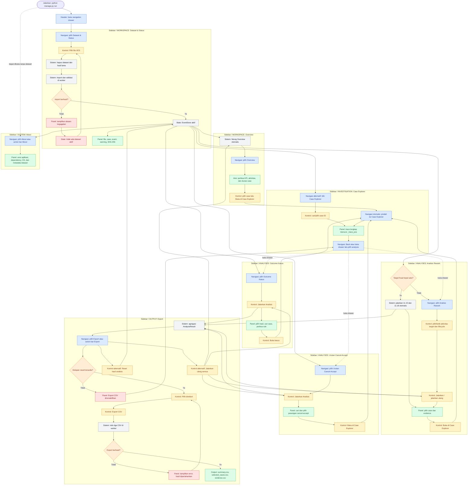
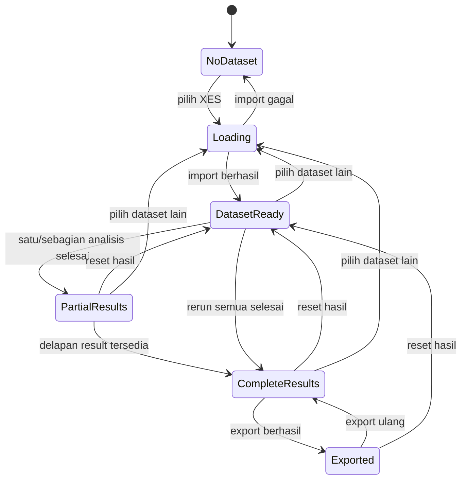
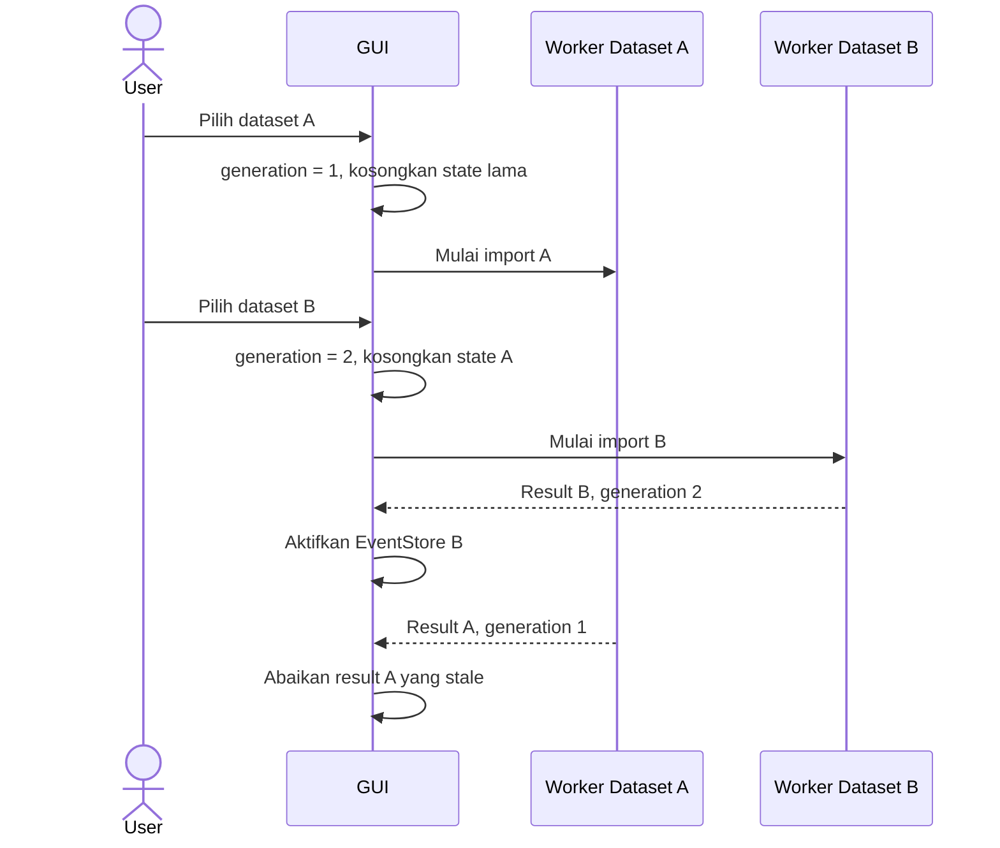

# User Flow — BPIC17 Desktop Event Log Analyzer

## 1. Tujuan

Dokumen ini menjelaskan alur pengguna dan perubahan state aplikasi mulai dari membuka aplikasi, mengimpor XES, menjalankan delapan analisis, menelusuri evidence, hingga mengekspor CSV.

Aktor utama adalah pengguna yang memiliki event log XES lokal dan ingin menjalankan analisis BPIC17 tanpa menyunting kode atau membaca ulang dataset untuk setiap analisis.

## 2. Titik masuk dan prasyarat

Prasyarat:

- Python 3.13 dan dependency pada `requirements.txt` telah terpasang.
- File `.xes` atau `.xes.gz` tersedia secara lokal.
- Pengguna memiliki izin baca untuk file XES dan izin tulis untuk direktori export.

Jalankan aplikasi dari root repository:

```powershell
python manage.py run
```

Saat aplikasi dibuka, delapan workspace tersedia melalui navigation drawer overlay:

1. Dataset & Status
2. Overview
3. Outcome Kasus
4. Analisis Rework
5. Urutan Cancel-Accept
6. Case Explorer
7. Export
8. About

Tombol menu pada header membuka drawer di atas workspace dan backdrop; drawer ditutup melalui tombol close, klik backdrop, `Escape`, atau setelah route dipilih. Grup route dapat dibuka dan ditutup tanpa mengubah halaman aktif. Header selalu menampilkan workspace aktif, breadcrumb, tombol Back/Forward, dan context dataset. Action bar bawah menyediakan Import, Reset, Rerun All, Export, dan About dari halaman mana pun. Belum ada dataset atau hasil analisis aktif pada state awal.

## 3. User flow utama



### Peta navigasi dan kontrol

| Tujuan pengguna | Navigasi | Kontrol atau aksi |
|---|---|---|
| Memilih atau mengganti XES | Tombol menu > drawer `Dataset & Status` atau action bar `Import XES` | `Pilih file XES` |
| Memeriksa KPI dan daftar case | Tombol menu > drawer `Overview` | Cari/pilih case, lalu `Buka di Case Explorer` |
| Menganalisis outcome kasus | Tombol menu > drawer `Outcome Kasus` | `Jalankan Analisis`, pilih hasil, lalu `Buka kasus` |
| Menganalisis rework | Tombol menu > drawer `Analisis Rework` | Pilih aktivitas/lifecycle, lalu `Jalankan analisis` |
| Menganalisis urutan cancel-accept | Tombol menu > drawer `Urutan Cancel-Accept` | `Jalankan Analisis`, pilih pasangan, lalu `Buka di Case Explorer` |
| Menelusuri trace secara langsung | Tombol menu > drawer `Case Explorer` | Ketik atau pilih case ID |
| Mengekspor hasil | Tombol menu > drawer `Export` atau action bar `Export` | `Pilih direktori`, lalu `Export CSV` |
| Menghapus hasil tanpa membuang dataset | Action bar `Reset` atau halaman Export | `Reset hasil analisis` |
| Menghitung ulang tanpa parse XES | Action bar `Rerun All` atau halaman Export | `Jalankan ulang semua` |
| Melihat versi dan metadata | Sidebar atau action bar `About` | Baca informasi environment dan dataset aktif |

### Shortcut navigasi

| Shortcut | Workspace/aksi |
|---|---|
| `Ctrl+B` | Buka atau tutup navigation drawer |
| `Escape` | Tutup navigation drawer bila sedang terbuka |
| `Ctrl+O` | Import XES |
| `Ctrl+1` … `Ctrl+8` | Dataset, Overview, Outcome, Rework, Urutan Event, Explorer, Export, About |
| `Alt+Left` / `Alt+Right` | Back / Forward pada navigation history |
| `Ctrl+R` | Rerun seluruh analisis dari EventStore aktif |
| `F1` | About |

## 4. Import dataset

### 4.1. Jalur sukses

1. Pengguna membuka drawer lalu memilih `Dataset & Status`, atau memakai `Import XES` pada action bar.
2. Pengguna menekan `Pilih file XES`.
3. Dialog hanya menawarkan XES, XES.GZ, atau semua file.
4. Setelah file dipilih, aplikasi segera:
   - menaikkan generation ID;
   - menghapus referensi dataset sebelumnya;
   - membersihkan Overview, hasil analisis, Case Explorer, Export, dan metadata About;
   - menampilkan progress indeterminate;
   - menonaktifkan tombol pilih file selama job aktif.
5. PM4Py membaca dan memvalidasi file di worker thread.
6. Jika berhasil, satu `EventStore` menjadi sumber data seluruh panel.
7. Dataset panel menampilkan nama file, jumlah case/event, SHA-256, dan warning loader.
8. About menampilkan versi runtime serta metadata dataset aktif.
9. Overview dihitung otomatis tanpa parsing ulang.

Pembersihan state lama dilakukan sebelum import selesai agar hasil dataset A tidak pernah terlihat sebagai hasil dataset B.

### 4.2. Jalur gagal

Import dapat gagal karena:

- file tidak ditemukan atau tidak dapat dibaca;
- path bukan file;
- XES rusak;
- atribut wajib hilang atau bernilai null;
- trace position, row ID, atau duration cache melanggar kontrak.

Respons aplikasi:

- progress dihentikan;
- tombol pilih file diaktifkan kembali;
- alasan kegagalan ditampilkan;
- dataset dan seluruh hasil lama tetap kosong;
- aplikasi tidak keluar atau crash.

## 5. Overview

Overview berjalan otomatis setelah `EventStore` aktif dan menampilkan:

- total case;
- total event;
- total aktivitas;
- rentang timestamp;
- mean cycle time;
- frekuensi aktivitas;
- daftar durasi case;
- metadata dan warning dataset.

Pengguna dapat mencari case dan membukanya di Case Explorer. Pembukaan dari Overview tidak membawa highlight khusus karena Overview bukan filter evidence analisis.

## 6. Outcome Kasus

1. Pengguna membuka drawer lalu memilih `Outcome Kasus`, atau menekan `Ctrl+3`.
2. Pengguna menekan `Jalankan Analisis`.
3. Lima hasil dihitung dari `EventStore` aktif di worker thread.
4. Tabel menampilkan kode analisis, metrik, count, mean days, dan denominator.
5. Pengguna memilih salah satu hasil untuk melihat rule dan case IDs.
6. Pengguna dapat mencari case, memilih satu baris, lalu menekan `Buka kasus`.
7. Case Explorer dibuka dengan event evidence yang sesuai disorot.

Hasil yang dihasilkan:

- 11.7 A: seluruh case;
- 11.7 B: mean cycle time seluruh case;
- 11.7 C: case yang mengandung `O_Accepted`;
- 11.7 D: case yang mengandung `O_Refused`;
- 11.7 E: case dengan event terakhir `O_Cancelled` menurut `_trace_pos`.

## 7. Analisis Rework

Setelah dataset aktif, aplikasi mencari aktivitas yang memuat kata `fraud`.

### Satu kandidat

Jika tepat satu kandidat ditemukan:

1. Aktivitas dipilih otomatis.
2. 11.15 dan 11.18 langsung dijalankan.
3. Hasil, case, lifecycle, resource, dan evidence ditampilkan.

### Kandidat ambigu atau tidak ditemukan

Jika kandidat lebih dari satu atau tidak ada:

1. Aplikasi tidak memilih target secara sembarang.
2. Pengguna memilih atau mengetik nama `concept:name` secara exact.
3. Pengguna memastikan nilai lifecycle complete yang digunakan.
4. Pengguna menekan `Jalankan / jalankan ulang`.

11.15 membutuhkan sedikitnya dua event target dengan lifecycle `complete` dalam satu case. 11.18 menambahkan syarat resource valid yang identik. Lifecycle/resource yang tidak memadai menghasilkan status `unavailable` atau notes batas bawah, bukan nol yang diklaim valid.

Pengguna dapat memilih case dan membuka seluruh evidence terkait di Case Explorer.

## 8. Urutan Cancel-Accept

1. Pengguna membuka drawer lalu memilih `Urutan Cancel-Accept`, atau menekan `Ctrl+5`.
2. Pengguna menekan `Jalankan Analisis`.
3. Aplikasi mencari case yang memiliki `O_Cancelled` di posisi `i` dan `O_Accepted` di posisi `j`, dengan `i < j`.
4. Panel menampilkan count, denominator, percentage, rule, notes, dan satu pasangan evidence per case.
5. Pengguna dapat mencari dan memilih pasangan evidence.
6. Timeline menunjukkan posisi dan timestamp cancel–accept.
7. Tombol `Buka di Case Explorer` membuka trace penuh dengan kedua event disorot.

## 9. Case Explorer

Case Explorer dapat dibuka langsung atau melalui action case dari Overview dan panel analisis.

Alurnya:

1. Pengguna mencari atau memilih case ID.
2. Aplikasi mengambil trace melalui case index pada `EventStore`.
3. Event diurutkan berdasarkan `_trace_pos`, bukan timestamp.
4. Tabel menampilkan seluruh event case.
5. `_row_id` yang dikirim panel asal ditandai sebagai highlight.
6. Informasi evidence menjelaskan jumlah dan urutan event yang disorot.

Jika case atau row ID tidak ditemukan pada dataset aktif, panel menampilkan pesan yang sesuai dan tidak menggunakan evidence dari dataset sebelumnya.

## 10. Export

Export memakai objek `AnalysisResult` yang sama dengan panel. Tidak ada perhitungan ulang analitik pada layer export.

### Syarat tombol Export aktif

- Dataset masih aktif.
- Delapan kode analisis tersedia tepat satu kali:
  - 11.7 A–E;
  - 11.15;
  - 11.18;
  - 11.22.
- Direktori output telah dipilih.

Status `unavailable` tetap dianggap sebagai hasil analisis yang lengkap apabila memiliki kode analisis, denominator, status, dan alasan. Nilai tersebut diekspor sebagai unavailable, bukan diubah menjadi hasil nol valid.

### Keluaran

| File | Isi |
|---|---|
| `summary.csv` | Delapan analisis, rule, count, denominator, mean, percentage, status, dan notes |
| `selected_cases.csv` | Kode analisis dan case ID terpilih |
| `evidence.csv` | Union evidence columns, termasuk row ID, posisi, timestamp, lifecycle/resource, atau pasangan cancel–accept |

Export berjalan di worker thread. Jika permission atau path bermasalah, hasil analisis tetap tersedia sehingga pengguna dapat memilih direktori lain dan mencoba kembali. Membatalkan dialog direktori tidak dianggap sebagai error dan tidak menghapus pilihan sebelumnya.

## 11. Reset dan rerun



### Reset hasil analisis

Tombol `Reset hasil analisis`:

- mempertahankan objek `EventStore` dan metadata dataset;
- menghapus Overview terhitung, hasil 11.7, 11.15, 11.18, dan 11.22;
- menghapus trace/highlight Case Explorer;
- mengosongkan agregasi hasil Export;
- membatalkan pengaruh callback analisis lama melalui generation ID;
- tidak memanggil parser XES.

### Jalankan ulang semua

Tombol `Jalankan ulang semua`:

1. mereset hasil turunan;
2. menghitung ulang Overview;
3. menjalankan 11.7 A–E;
4. menjalankan 11.15/11.18 dengan target dan lifecycle yang sedang dipilih;
5. menjalankan 11.22;
6. menyinkronkan delapan result ke panel Export.

Jika target rework belum dipilih, 11.15/11.18 menghasilkan status unavailable dengan alasan yang dapat diperbaiki pengguna.

## 12. Pergantian dataset dan concurrency

Setiap load, analisis, dan export memiliki generation context.



Worker tidak memodifikasi widget secara langsung. Result/error diteruskan ke GUI thread. Dengan demikian, operasi berat tidak membekukan event loop dan callback lama tidak mengotori dataset baru.

## 13. Matriks aksi dan recovery

| Aksi/kondisi | Respons sistem | State akhir | Recovery pengguna |
|---|---|---|---|
| Membuka aplikasi | Menampilkan header, workspace, action bar, dan tombol drawer | Tidak ada dataset | Buka drawer atau pilih Import XES |
| Memilih XES valid | Validasi di worker, membuat EventStore | Dataset aktif | Jalankan analisis |
| Memilih XES rusak/hilang | Menampilkan alasan, membersihkan state lama | Tidak ada dataset | Pilih file lain |
| Aktivitas fraud tunggal | Menjalankan 11.15/11.18 otomatis | Dua hasil rework tersedia | Tinjau atau rerun |
| Aktivitas fraud ambigu | Meminta target exact | Rework belum lengkap | Pilih target lalu jalankan |
| Lifecycle/resource tidak cukup | Menghasilkan `unavailable` dan notes | Result tetap dapat diaudit | Gunakan dataset/atribut yang benar |
| Membuka case result | Beralih ke Explorer dan menyorot evidence | Trace case aktif | Kembali ke panel atau cari case lain |
| Hasil belum delapan | Export dinonaktifkan | Partial results | Jalankan analisis yang hilang |
| Cancel dialog export | Tidak mengubah hasil atau path lama | State sebelumnya | Pilih direktori bila diperlukan |
| Export permission gagal | Menampilkan error, hasil dipertahankan | Complete results | Pilih lokasi writable |
| Reset hasil | Menghapus hasil, mempertahankan store | Dataset ready | Jalankan panel atau rerun semua |
| Rerun semua | Menghitung dari store aktif | Delapan result/unavailable | Perbaiki target bila diperlukan |
| Memilih dataset baru | Menghapus seluruh hasil lama | Loading/dataset baru | Tunggu import selesai |

## 14. Expected output per tahap

| Tahap | Output yang diharapkan |
|---|---|
| Import | EventStore tervalidasi, metadata file, SHA-256, case/event count |
| Overview | KPI log, frekuensi aktivitas, dan durasi case |
| 11.7 | Lima `AnalysisResult` |
| Rework | Dua `AnalysisResult` untuk 11.15 dan 11.18 |
| 11.22 | Satu `AnalysisResult` dengan percentage dan pasangan evidence |
| Explorer | Trace utuh satu case dan highlight evidence |
| Export | Tiga CSV UTF-8 yang dapat dibaca kembali |
| About | Versi aplikasi, Python, dependency, OS, dan metadata dataset |

## 15. Batas verifikasi

- User flow telah diuji menggunakan XES sintetis dan automated integration tests.
- Dataset BPIC17 asli tidak tersedia di repository; hasil numerik, performa file penuh, dan screenshot data asli belum diverifikasi.
- Nama aktivitas target, lifecycle, dan resource tetap bergantung pada atribut dataset aktual.
- File export dapat mengandung identifier sensitif dan tidak boleh di-commit tanpa pemeriksaan.
